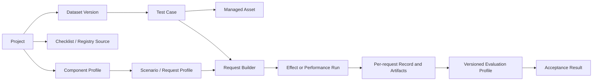

# 11 真实评测项目模式分析

## 1. 目的、范围与证据边界

本文把开发者本机 `D:\work_2026` 中多个既有评测项目的结构和操作文档，与 AI-PERF 当前规格对照，提炼可复用的产品边界。资料目录包含多项目、多版本清单、工具包、样例数据、报告和附件；本次对一级项目目录作了文件类型盘点，并抽查了接线识别、南网科技组件全量测试、安监、花钱问效、肇庆四位一体、阳江局微应用、空天地一体化巡视、新能源及基模等代表性项目。

本次检查以 README、指标说明、脚本接口、表格结构、配置键名和脱敏后的用例结构为证据。没有把项目数据、凭据、接口地址或原始响应复制进 AI-PERF，也没有修改 `D:\work_2026` 中的文件。样本抽查说明了现实中存在的差异，不代表所有项目的格式和验收规则已经批准为 AI-PERF 的统一标准。

## 2. 从项目中观察到的稳定模式

| 观察到的模式 | 项目证据 | 对 AI-PERF 的含义 |
|---|---|---|
| 组件清单与可执行用例是两种资料 | 多个项目的组件清单工作簿包含组件名称/版本、功能层级、类型、接口说明、输入输出示例、验收标准、附件和开发状态；另有 JSON/JSONL 用例文件及附件目录 | 清单适合作为组件登记、接口说明和验收依据；只有经过选择、映射和校验的用例才进入执行。不能把整张组件清单直接当成 Dataset 行，也不能默认每份清单都是同一模板 |
| 工作簿标题行和版本并不统一 | 有的工作簿标题/说明行在数据行之前，实际表头并非第一行；不同项目和修订版的列数、工作表及表头不同 | 导入预览必须让用户确认工作表、标题行、数据范围和映射；不能假定固定列号、固定 sheet 或自动猜测语义 |
| 用例存在多种结构，且 expected 不同构 | 有的文件是 JSON 数组，有的是按组件拆分的 JSONL；用例可能含 `case_id`、`component_id`、`input_paths`、可选 `payload`、`expected`、`source`、`metadata`，其他项目还有多轮历史或结构化业务字段 | 核心数据模型应保留 JSON 原生类型并允许显式 schema；附件引用、预期结果和来源信息应独立字段化；不应要求所有业务字段都塞进一个固定输入模板 |
| 一个组件名不保证对应一种请求 | 同一组件可按场景使用不同输入字段、不同输出变量、不同 JSON 深度；项目中同时出现普通 HTTP JSON、Dify workflow/chat、流式响应及文件上传后再调用工作流 | 请求构造、传输协议、响应抽取都应通过显式 profile/adapter 配置；需要按组件或场景绑定，不能靠组件名称或 HTTP 200 推断业务格式 |
| 文件既可能是本地附件，也可能是服务端文件引用 | 图像、PDF、表格、多文件、前后对比样本、上传接口返回的 file ID、已经存在的远端 file ID 都实际出现 | 用例应引用受管理的 Asset 或显式 RemoteFileRef；本地文件上传步骤和远端文件 ID 不能混为一类字符串；before/after 等配对关系应可表达且顺序稳定 |
| 效果评估与性能压测分开执行和重评 | 多个项目使用 `effect_run/effect_eval` 与 `perf_run/perf_eval`；原始结果先落盘，之后可离线调整评估规则并重算报告 | 执行只采集事实；评估只读取已保存的运行记录和版本化规则。效果准确率、业务符合率和性能成功率需分别定义 |
| 效果判定不只有二元答案 | 项目使用结构/关键词/业务断言、参考答案、数值容差、负例、不可评估、人工复核等方式；没有人工标注或明确数值标准时，有项目将结论留为 N/A | 每条评估断言应能记录 PASS、FAIL、NOT_EVALUABLE 或 MANUAL_REVIEW；未完成复核不能静默变为通过，单独的 HTTP 成功也不代表业务成功 |
| 性能口径受服务行为和测试类型影响 | 项目使用过固定请求数和并发、按时长运行、阶梯并发、冷却、去重样本、目标成功数、effect 重试/perf 不重试等策略；有服务按业务 ID 返回冲突或去重 | 当前 AI-PERF 首期固定请求数 + 固定并发保持为唯一负载模式。重试、样本复用、预热、服务端去重和运行时长应作为独立、可见的配置或诊断，不能混淆逻辑请求与尝试次数 |
| 数据清洗和结果都需要追溯 | 有项目记录数据集版本、来源、父版本、清洗规则、增删改数量；报告按批次保存逐请求结果和聚合结果 | Run 快照至少绑定 DatasetVersion、用例 ID 与顺序、Asset 哈希、请求/评估 profile 版本、代码版本和执行参数；重新整理数据应生成新版本 |

## 3. 需要在领域模型中明确的对象边界

建议使用下列关系组织配置和数据。它是对现有规格的澄清建议，不等于所有字段已经冻结。



### 3.1 组件清单（Checklist / Registry Source）

表示组件、功能层级、版本、协议说明、输入输出示例、附件说明和验收来源。导入时保留原文件哈希、工作表、行号、表头位置及映射版本。清单导入只建立待审核草稿；不会自动启用目标地址、凭据或压测任务。

### 3.2 组件与场景 Profile

`ComponentProfile` 描述一个被测对象和环境绑定；`ScenarioProfile` 描述该组件某个场景的请求构造方式、步骤、响应抽取方式和引用的评估规则。一个组件可有多个场景，一个场景也可以使用多个 RequestStep（例如文件上传后调用 workflow）。环境地址与密钥分开：配置保留 secret ID，真实值只由执行端本机解析。

Profile 不应把业务验收规则硬编码进 HTTP 客户端。传输层只报告请求、响应和错误事实；响应抽取与评估由独立的版本化 profile 完成。

### 3.3 DatasetVersion 与 TestCase

建议把通用 `DatasetRow(values)` 具体化为“保留原始值的 TestCase”，而不是规定一个全行业务 payload：

```json
{
  "case_id": "case-001",
  "component_id": "component-01",
  "scenario_id": "scenario-01",
  "values": {"question": "...", "history": []},
  "payload": null,
  "asset_refs": [{"asset_id": "asset-001", "role": "input"}],
  "expected": {"format": "rules-v1", "value": {}},
  "provenance": {"source_file": "cases.jsonl", "source_line": 1}
}
```

示例中的业务内容是占位符，不对应任何被审阅项目。`values` 保留字符串、数字、布尔值、null、数组和对象；`payload` 可为空，由 Request Builder 根据显式映射生成，也可在确有需要时保存经过校验的完整请求体。`expected` 保留 JSON 原生类型，但必须绑定解释它的 evaluator/schema 版本；不能假设它是字符串或与输入同构。`asset_refs` 引用受管理附件，不把本地绝对路径写进用例或任务包。

导入诊断定位到文件、工作表/行/列或 JSONL 行号/字段路径。无法解释的行应显示为错误或待映射项，不静默跳过。源文件哈希、清洗记录和映射版本共同构成 DatasetVersion；已用于 Run 的版本不可覆盖。

### 3.4 Asset 与远端文件引用

`Asset` 表示由 AI-PERF 管理、可校验哈希并可安全流式读取的本地文件。`RemoteFileRef` 表示目标服务已经持有的文件标识，不能伪装成用户本机路径。请求步骤应明确使用哪种文件来源；上传产生的服务端 ID 是运行时输出，可供后续步骤引用，不应写回或覆盖原始 DatasetCase。

文件名只作展示元数据；存储路径由 AI-PERF 生成。解析、预览或 cURL 导入不能读取其声明的本机路径。执行时只有经过根目录校验并由 Run 快照引用的资产才可进入请求体。

### 3.5 Run、Attempt、Record 与 Evaluation

- **Run** 固定 effect/performance 类型、请求数、并发、超时、组件/场景、DatasetVersion、样本选择顺序、Profile 版本和代码版本。
- **Logical request** 对应一次计划内用例；**Attempt** 对应该逻辑请求的单次网络尝试。若启用重试，必须保留两者关系，防止把重试次数误计为样本数或吞吐。
- **RequestRecord** 保存可审计的请求时间点、脱敏请求摘要、传输结果、HTTP 元信息、受限响应摘要和产物引用。完整响应正文默认不进入通用报告/任务包。
- **Evaluation** 离线消费版本化的业务断言和请求记录，保存每条断言及结果；**Acceptance** 根据显式硬阈值输出 PASS/FAIL，缺少阈值或证据不足时输出 NOT_EVALUABLE，而非推定通过。

人工审核应是独立状态；只有明确审核完成的样本才参与对应的人工指标。性能中的“完整业务结果成功”也必须由被测场景的成功规则定义，不能统一等于 HTTP 2xx。

## 4. 真实项目对现有规格的澄清

1. **“Excel 支持”拆成两项能力。** Excel 作为被测 API 的附件上传，属于真实文件请求链路；读取 XLSX/XLS 工作簿并导入组件清单或测试用例，是数据导入适配器。两者安全边界、验收标准和开发顺序不同。`.xlsx` 附件可被 API 接收，不代表 AI-PERF 首版必须把任意 XLSX 当成用例表解析；反之亦然。
2. **用例导入必须预览并显式映射。** 先选文件、表、标题行、数据范围和字段映射，再生成可审核的 DatasetVersion；清单模板与用例文件分开导入。
3. **请求配置应按场景版本化。** 组件列表不等于统一请求格式；显式选取 HTTP JSON、Dify workflow/chat、流式返回或文件上传等适配器。未知响应形状不自动猜字段。
4. **效果阈值与压测参数不能混放。** Effect 规则、Performance 规则、请求超时/重试和负载参数分别配置；每项阈值记来源、版本、单位和统计口径。历史项目阈值只作为证据，不自动成为默认值。
5. **先固定可复现实验语义。** 首期固定请求数 + 固定并发；记录用例顺序和重复样本情况。duration、阶梯并发、恒定 RPS、目标成功数等历史运行模式列为后续能力。
6. **区分数据包、报告和本机凭据。** 任务包只放运行必需数据和 secret ID，不放真实凭据；原始业务响应和附件的保留、脱敏、导出需有单独策略。

## 5. 建议和待确认项

### 可直接作为实现原则

- 组件登记、TestCase Dataset、Asset、Request/Scenario Profile、Evaluation Profile、Run Snapshot 是不同对象。
- 配置和数据导入必须保留来源、版本和校验诊断；用例顺序可复现。
- 请求执行与离线评估分离；HTTP、业务判定、人工复核、硬阈值准出分别记录。
- 本机文件上传与服务端既有 file ID 分开建模；附件通过受控 Asset 引用。
- Secret 值不写入 Dataset、Profile 导出、运行报告或任务包。

### 开始对应适配器前需要确认

1. 哪一版组件清单是权威模板；是否需要在产品首版导入该清单，还是先手工维护 ComponentProfile。
2. 首版执行 Dataset 的正式格式清单：CSV/JSON/JSONL/XLSX 哪些必须导入；`.xls` 是否只接受为 API 附件，还是也需解析工作簿。
3. 测试数据、附件、行数、单文件大小、总附件大小、运行记录和响应摘要的上限与保留期限。
4. 多轮对话、图像成对、视频、远端 file ID、多步上传工作流分别属于首版还是后续能力。
5. 人工复核的分配/状态/计数口径；哪些评估方式可自动准出，哪些只提供差异报告。
6. Response 正文和附件是否允许落盘、如何脱敏、谁可导出及导出期限。
7. 各组件性能成功条件、是否允许 effect 重试、样本复用与冷却策略的业务批准值。

确认这些事项前，具体限制和 evaluator 能力应标为“建议基线”或“待确认”，不要从某个项目复制成全局固定值。

## 6. 本次抽查的代表性证据

以下仅列资料类别和项目目录，未引用其凭据、目标地址、样本内容或原始返回：

| 本地项目类别 | 检查到的证据类型 |
|---|---|
| 接线识别工具包 | README、指标口径、共享请求库、effect/perf 执行与评估脚本、组件清单及脱敏样例结构 |
| 南网科技全量组件测试 | 离线工具包 README、按组件分区的 JSONL、预检/执行/评估/准出命令及 evaluator 模块 |
| 花钱问效 | 版本化测试配置、用例文件、数据清洗变更记录、effect/perf 评估说明 |
| 安监 | 组件/效果/性能清单和按任务模态拆分的历史脚本 |
| 肇庆、阳江、空天地 | 多组件配置、JSON/JSONL 用例、Dify/chat/文件上传步骤及结果报告说明 |
| 新能源资料审核 | PDF 文件引用、业务规则用例、完整审查判定与性能执行说明 |
| 基模 | Token 输入/输出长度、TTFT、ITL、单请求吞吐与系统总吞吐的独立模型压测报告 |

这些证据证明需要配置化和分层；不证明所有项目都使用同一清单、同一协议、同一数据文件或同一指标公式。
